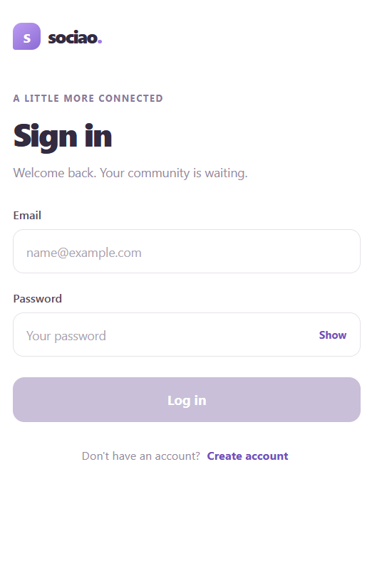
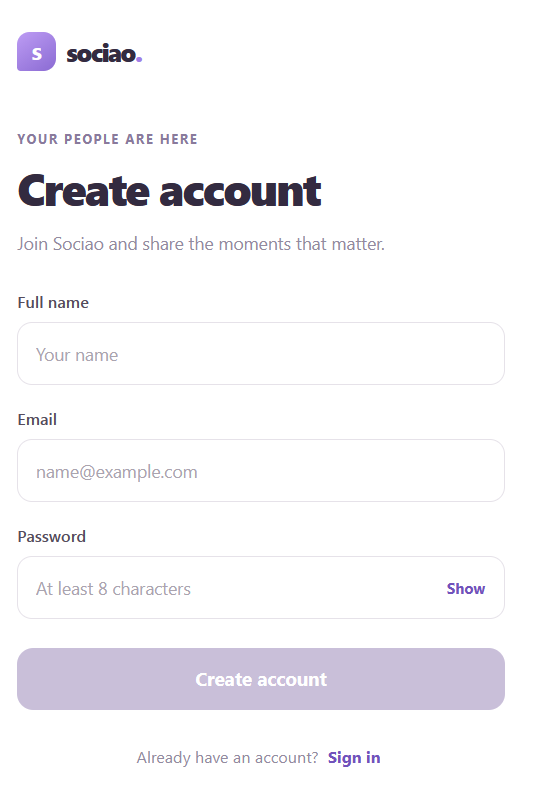
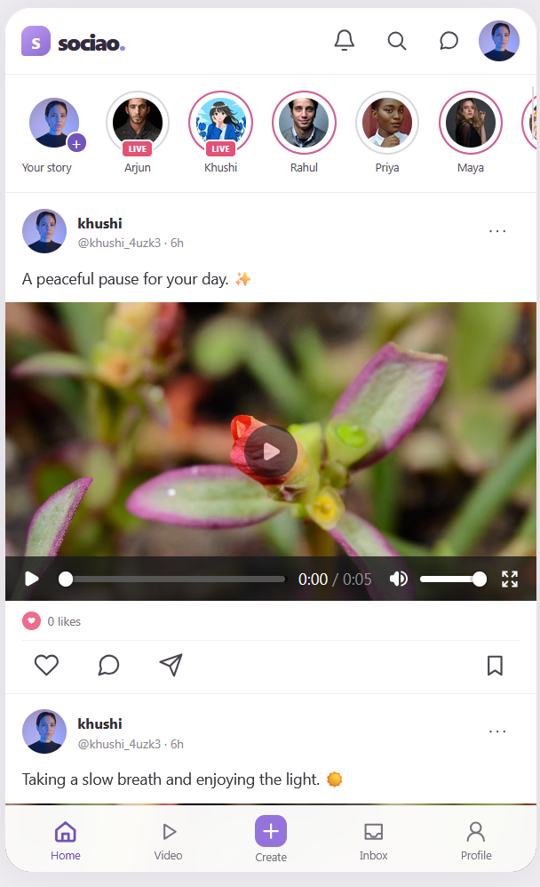
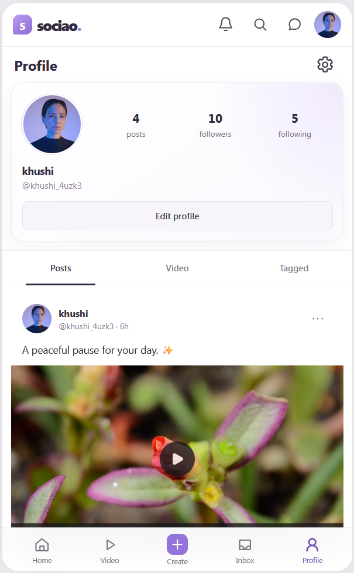
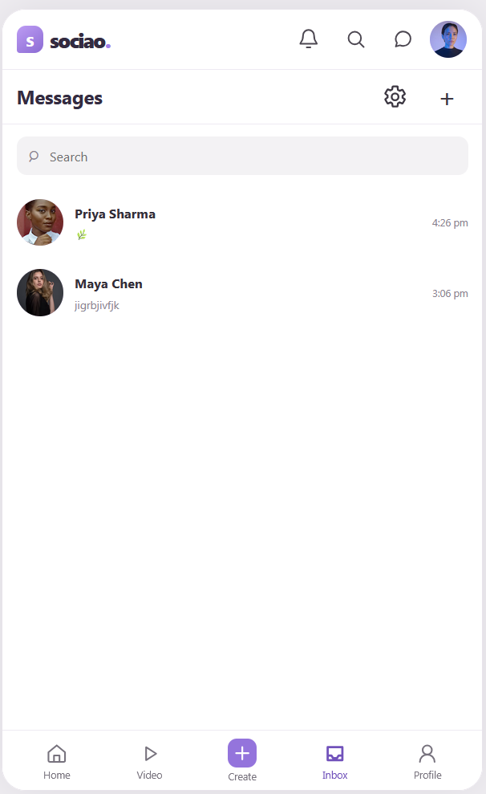
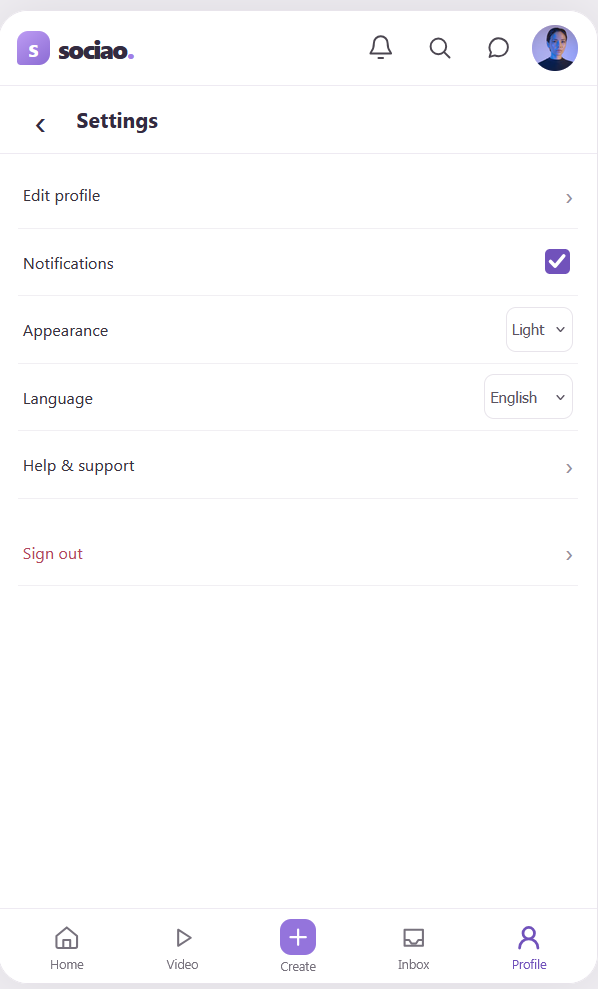

# 📸 Sociao – Social Media Application

**Connect. Share. Express.**

Sociao is an Instagram-inspired social media web application designed to provide users with a platform to connect, share content and interact with others. Users can create accounts, log in securely, explore posts, publish their own content and engage with posts through likes.

The application is built with a **React frontend, Python FastAPI backend and SQLite database**, following a frontend-backend architecture with REST APIs.

## ✨ Key Highlights

- 🔐 Secure user registration and authentication
- 📰 Social media feed for viewing posts
- 📷 Create and share posts
- ❤️ Like and unlike posts
- 💾 Persistent storage using SQLite
- 🔗 REST API integration between frontend and backend
- 📱 Responsive interface designed for different screen sizes

## 🛠️ Technology Stack

| Technology | Purpose |
|---|---|
| ⚛️ React | Building the user interface |
| ⚡ Vite | Frontend development and build tool |
| 🎨 CSS | Styling and responsive layouts |
| 🐍 Python | Backend development |
| 🚀 FastAPI | REST API development |
| 🗄️ SQLite | Database storage |
| 🔄 SQLAlchemy | Database ORM |
| 🔒 Argon2 | Secure password hashing |

## 📂 Project Structure

```text
sociao/
├── frontend/
│   └── src/
│       ├── components/
│       ├── App.jsx
│       ├── api.js
│       └── ...
├── backend/
│   ├── main.py
│   ├── database.py
│   ├── models.py
│   ├── schemas.py
│   ├── auth_routes.py
│   ├── post_routes.py
│   ├── media_routes.py
│   ├── security.py
│   └── seed.py
├── screenshots/
├── README.md
└── PROMPT_HISTORY.md
```

## 🚀 Getting Started

Follow these steps to run Sociao locally.

### Prerequisites

- Python 3.10 or later
- Node.js and npm
- Git

### 1. Clone the Repository

```bash
git clone https://github.com/khuahirahangdale/sociao-social-media-app.git
cd sociao-social-media-app
```

### 2. Start the Backend

```bash
cd backend
python3 -m venv venv
source venv/bin/activate
pip install -r requirements.txt
uvicorn main:app --reload --host 0.0.0.0 --port 8000
```

Backend: `http://localhost:8000`

API Documentation: `http://localhost:8000/docs`

### 3. Start the Frontend

Open a second terminal:

```bash
cd frontend
npm install
npm run dev
```

Open the frontend URL displayed in your terminal, usually:

`http://localhost:5173`

## 🗄️ Database Schema

Sociao uses SQLite with SQLAlchemy for database management.

| Table | Description |
|---|---|
| Users | Stores user account information |
| Posts | Stores posts created by users |
| Likes | Stores post likes and user relationships |
| LoginSession | Stores hashed authentication tokens and session details |

### Database Relationships

- One user can create multiple posts.
- One user can like multiple posts.
- One post can receive likes from multiple users.
- A user can like a particular post only once.
- Login sessions are associated with user accounts.

## 🔐 Authentication & Security

- User passwords are hashed using Argon2 instead of being stored as plain text.
- Token-based authentication is used to validate users.
- Authentication sessions are stored in the database using hashed tokens.
- Protected API endpoints require valid authentication.
- Logout revokes the user's session.

## ✅ Implemented Features

- User registration and login.
- Password validation and secure password hashing.
- Token-based authentication and logout.
- Session validation and restoration.
- Demo users and posts through database seeding.
- Home feed with posts.
- Post creation.
- Like and unlike functionality.
- Persistent database storage.
- React frontend integration with FastAPI endpoints.

## 🚧 Pending / Not Yet Verified

The following features are planned or still require complete implementation and testing:

- 💬 Comments and threaded replies.
- 📖 Stories and live functionality.
- 🎬 Full-screen video viewer and interactions.
- ✉️ Messaging inbox and chat.
- 👥 Followers and following management.
- ✏️ Edit profile functionality.
- 🔔 Notifications and application settings.
- 📤 Complete media upload and storage workflow.

## 🔮 Future Improvements

- Complete all remaining social media screens.
- Improve mobile and desktop responsiveness.
- Implement complete media upload and video support.
- Add comments, messaging and social interactions.
- Improve application performance and security.
- Add automated testing and deployment.

## 📌 Project Status

**Sociao is currently under active development.**

The core authentication, database integration and post-management functionality have been implemented. Additional social media features are being developed and tested as part of the project.

---

Made with ❤️ using React, Python and FastAPI.


## Screenshots

### Login Page


### Create Account


### Home Page


### Profile Page


### Messages


### Settings
